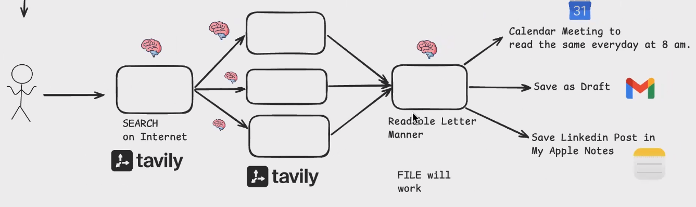

# Project - MCP - AI Newsletter

* This project will be done without code — Using claude desktop
*

    <figure><figcaption></figcaption></figure>
* We will be needing LLM to search the internet
* Next logical step is to based on the results we do follow up query
* For creating readable letter we will be needing LLM
* For search we will be using tavily
* Add Google connector
* Add Tavily connector
* Add apple notes connector
* Give the requirement to claude and ask to create a prompt
*
