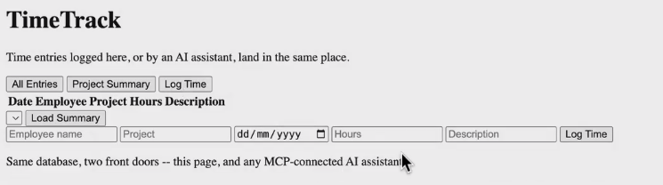
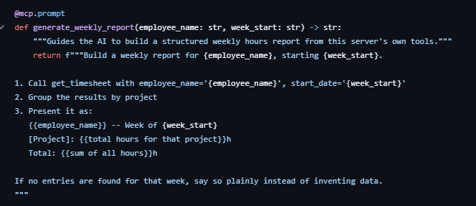

# Project - MCP - Time Track

*   [https://github.com/mayank953/Live-Class-2026/tree/main/Complete%20MCP/TimeTrackProject](https://github.com/mayank953/Live-Class-2026/tree/main/Complete%20MCP/TimeTrackProject)

    <figure><figcaption></figcaption></figure>
* uv init .
* database.py
  * initialize db connection
  * create table if it does not exists
  * list\_all\_entries()
  * log\_time ⇒ pass employee, project, time
  * get\_timesheet ⇒ for an employee and date
  * list\_projects()
  * get\_project\_summary
* main.py
  * create mcp server
  * Create tools for the methods&#x20;
  * Create resource for list of projects
  * Create prompt for weekly report
  *

      <figure><figcaption></figcaption></figure>
* Go to prefect horizon
*
